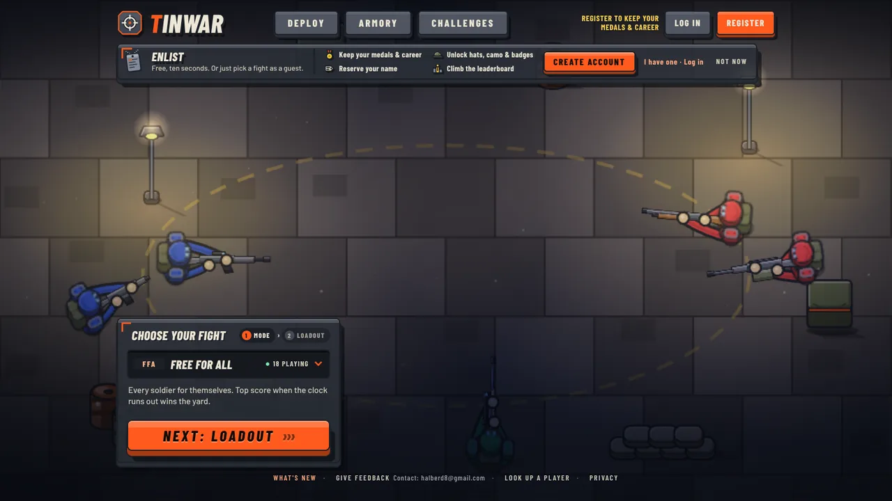
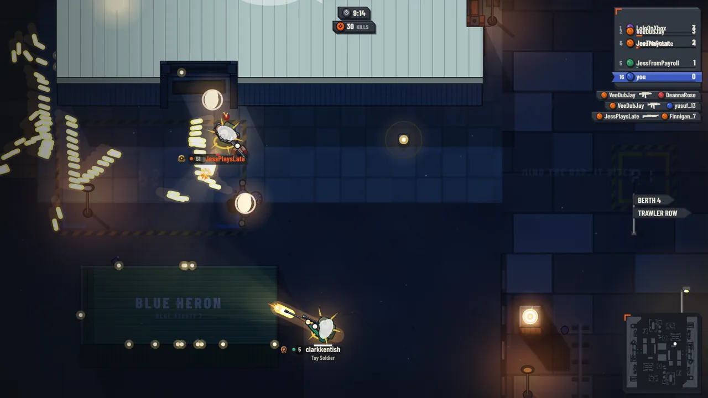
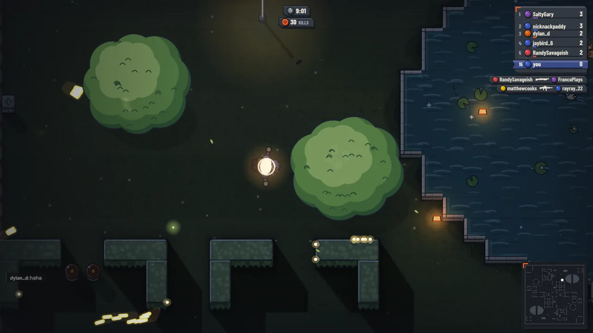
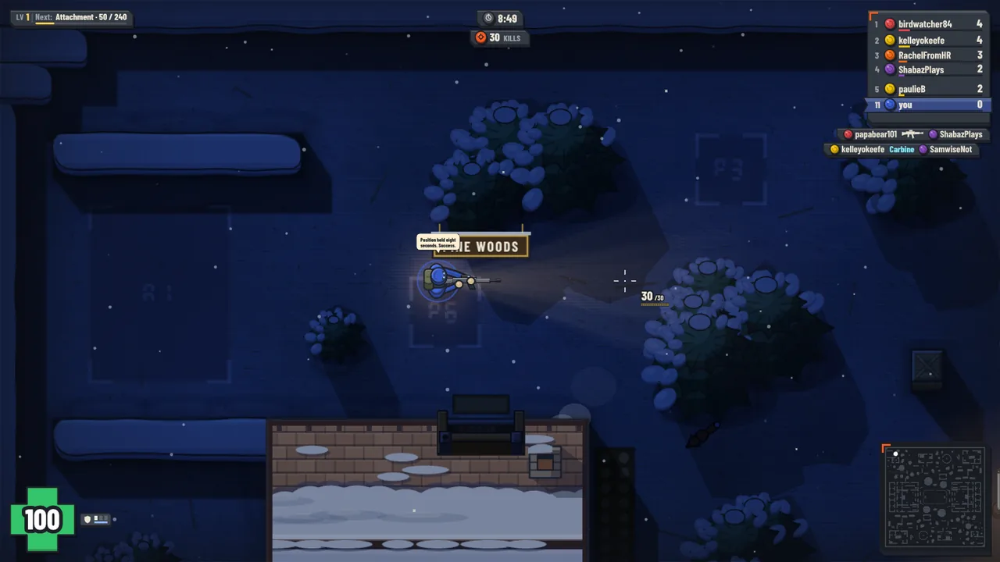
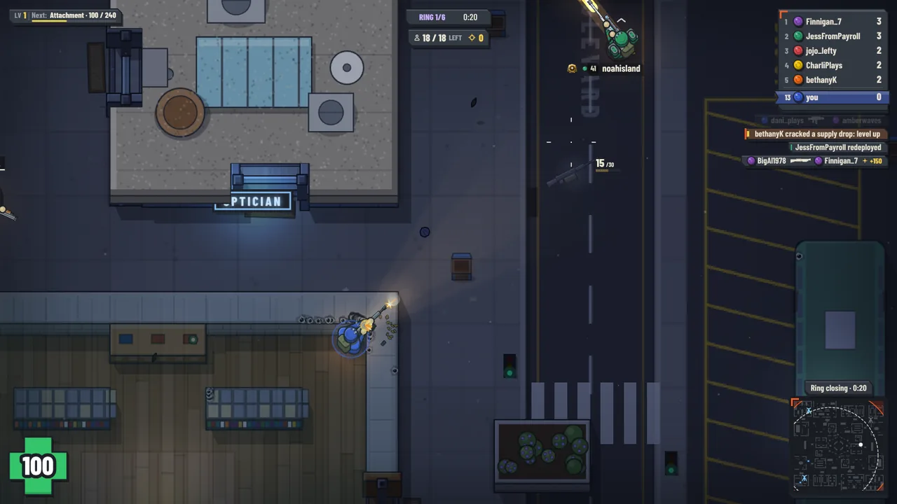
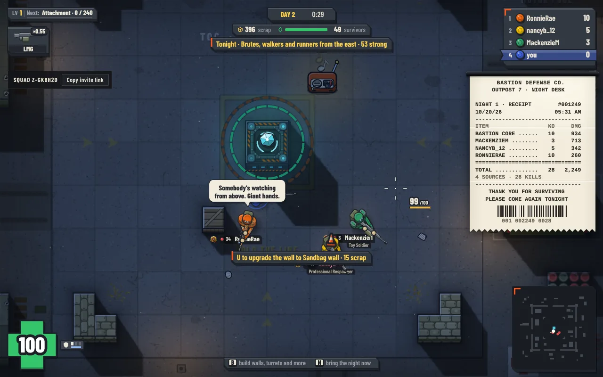
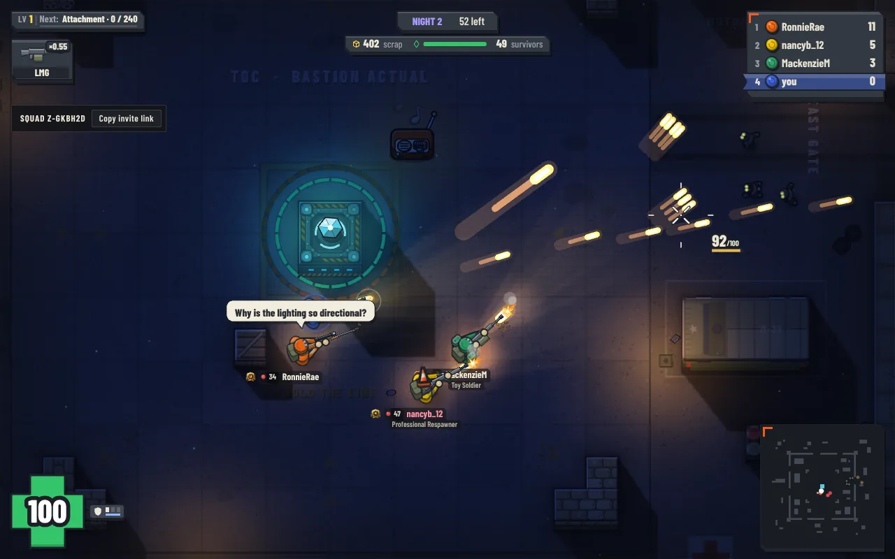
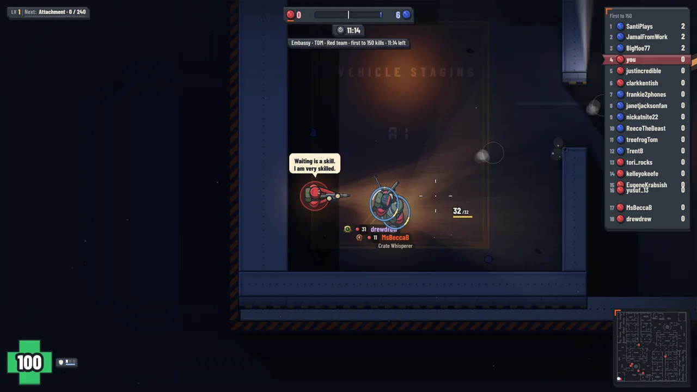
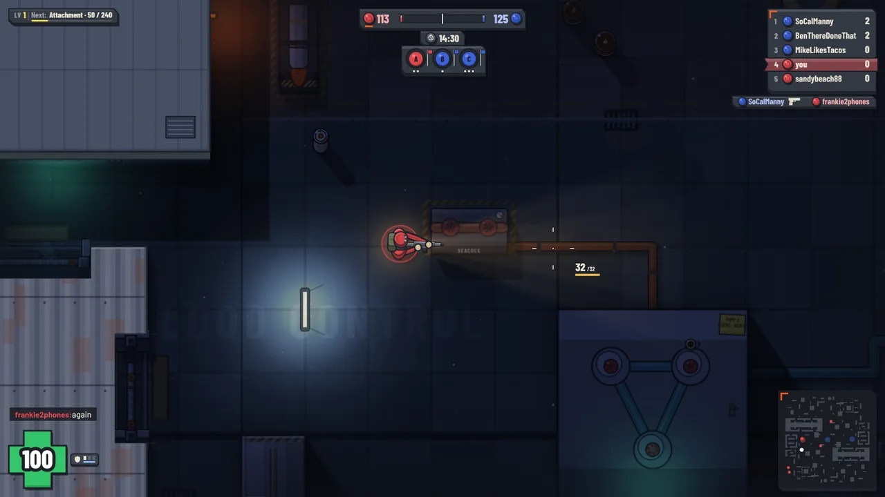
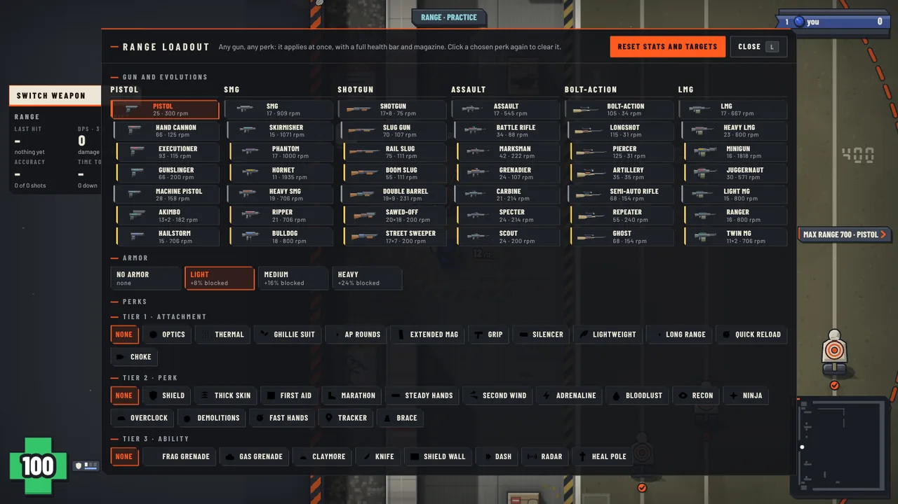

# Tinwar

Tinwar is a top-down multiplayer arena shooter for the browser. Its gameplay is modeled on gats.io. The name, art and code are original. Play it at https://tinwar.io.



## Screenshots

| | |
|---|---|
|  |  |
| **Causeway.** A working harbour at night: quays, berths, lamps and moored ships. | **Park.** Hedges, lily ponds and lamplight on the water. |
|  |  |
| **Summit Lodge.** Snow, pines and a ski lodge. | **Last Standing.** Battle royale with a closing ring, supply drops and redeploys. |
|  |  |
| **Zombies, day.** Build and upgrade around the Bastion; last night's damage prints on a receipt. | **Zombies, night.** Hold the core against the horde with your squad. |
|  |  |
| **Team Deathmatch.** Hold Tab for the whole board. | **Domination.** Take and hold zones A, B and C. |



**Shooting range.** A private practice room where any gun, evolution, armor and perk applies at once.

## Run

```bash
npm install
npm start
```

Open http://localhost:8080. Set `PORT` to change the port. Accounts and stats are saved in `data/`.

## At a glance

- **Modes:** Free for All, Team Deathmatch, Domination, Last Standing (battle royale), co-op Zombies for a squad of up to four, and a private shooting range. Bots keep every versus room at 18 players or more.
- **Guns:** six classes (pistol, SMG, shotgun, assault, sniper, LMG), each with two evolution stages of sidegrades, plus attachments, perks and abilities earned during a life.
- **Maps:** a rotation of hand-built 6000 px maps, from a night harbour to a snowed-in ski lodge, with props to shoot, swing doors, airdrops and radios to tune.
- **Art:** toy soldiers fighting a real night op. Flat cel-shaded shapes, ink outlines and real lighting (see the [art bible](docs/art/STYLE.md)).
- **Phones:** plays on its side with twin touch sticks.

## Docs

Playing

- [Play](docs/PLAY.md): modes, maps, controls, the look and phones
- [Combat](docs/COMBAT.md): health, weapon roles, bloom, handling, sprint, attachments, perks, abilities and medals
- [Arena hazards and props](docs/ARENA.md): barrels, airdrops, props and their medals
- [Zombies](docs/ZOMBIES.md): the co-op base-defense mode
- [Last Standing](docs/LAST_STANDING.md): the battle royale mode
- [Shooting range](docs/SHOOTING_RANGE.md): the private practice room
- [Music and radios](docs/RADIOS.md)
- [Progression](docs/PROGRESSION.md): levels, XP, cosmetics and challenges
- [Accounts and profiles](docs/ACCOUNTS.md): guests, registration, email and password reset

Building

- [Architecture](docs/ARCHITECTURE.md): code layout and performance
- [Verify](docs/VERIFY.md): typecheck, tests and benchmarks
- [Deploy](docs/DEPLOY.md): Docker, Fly.io and the optional LLM bot chat
- Deep dives: [art](docs/art/README.md), [map geometry](docs/maps/GEOMETRY.md), [vehicles](docs/maps/VEHICLES.md), [ambient life](docs/maps/AMBIENT.md), [music](docs/music/CRAFT.md), [bots](docs/bots/GAP.md)
